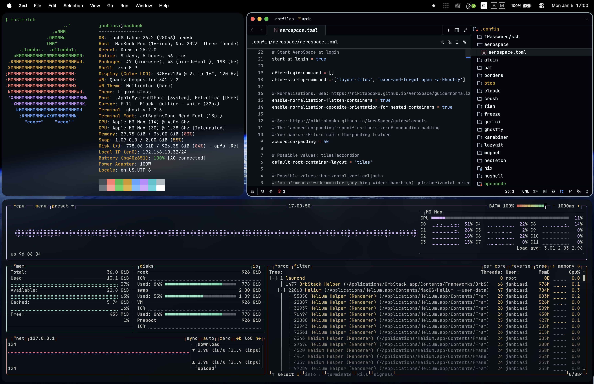
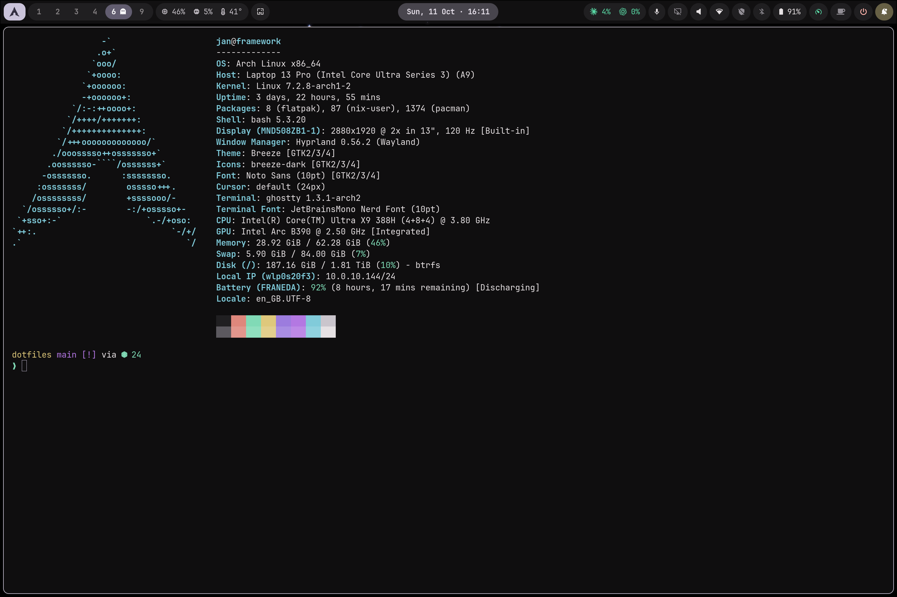

<p align="center">
    
    
</p>
<p align="center">
    <a href="#requirements">Requirements</a> · <a href="#included-configurations">Included Configurations</a> · <a href="#installation">Installation</a> · <a href="#available-tasks">Tasks</a>
</p>

## Dotfiles

This directory contains the dotfiles for my development environment.

**Shell split:** zsh on macOS, bash on Arch Linux.

### Requirements

- [Git](https://git-scm.com/)
- [Stow](https://www.gnu.org/software/stow/)
- [Make](https://www.gnu.org/software/make/)

### Included Configurations

- [1password](https://1password.com)
- [aerospace](https://nikitabobko.github.io/AeroSpace/guide) :apple:
- [atuin](https://atuin.sh/)
- [bash](https://www.gnu.org/software/bash/)
- [bat](https://github.com/sharkdp/bat)
- [btop](https://github.com/aristocratos/btop)
- [claude](https://www.claude.com/product/claude-code) 🧠
- [codex](https://openai.com/index/introducing-codex/) 🧠
- [devbox](https://www.jetify.com/devbox)
- [ghostty](https://ghostty.org/)
- [herdr](https://herdr.dev/)
- [hyprland](https://hypr.land/) :penguin:
- [jankyborders](https://github.com/FelixKratz/JankyBorders) :apple:
- [karabiner elements](https://karabiner-elements.pqrs.org/) :apple:
- [lazygit](https://github.com/jesseduffield/lazygit)
- [pi](https://pi.dev/) 🧠
- [plannotator](https://plannotator.ai/) 🧠
- [matugen](https://github.com/InioX/matugen)
- [neovim](https://neovim.io/)
- [nix](https://nixos.org)
- [opencode](https://opencode.ai/) 🧠
- [pi](https://pi.dev) 🧠
- [posting](https://posting.sh/)
- [ripgrep](https://github.com/BurntSushi/ripgrep)
- [sketchybar](https://github.com/FelixKratz/SketchyBar) :apple: _(currently unused)_
- [starship](https://starship.rs)
- [swaync](https://github.com/ErikReider/SwayNotificationCenter) :penguin:
- [television](https://github.com/alexpasmantier/television)
- [tmux](https://github.com/tmux/tmux)
- [voxtype](https://voxtype.io/)
- [vhs](https://github.com/charmbracelet/vhs)
- [waybar](https://github.com/alexays/waybar) :penguin:
- [waypaper](https://github.com/anufrievroman/waypaper) :penguin:
- [yay](https://github.com/jguer/yay) :penguin:
- [yazi](https://github.com/sxyazi/yazi)
- [zed](https://zed.dev)
- [zsh](https://www.zsh.org/) :apple:

## Installation

### macOS

#### 1. Install required software

```sh
xcode-select --install
/bin/bash -c "$(curl -fsSL https://raw.githubusercontent.com/Homebrew/install/HEAD/install.sh)"
brew install stow make
```

#### 2. Clone Repository

```sh
git clone https://github.com/janbiasi/.dotfiles.git
cd .dotfiles
```

#### 3. Apply macOS configuration

```sh
make configure-macos
```

#### 4. Install dependencies

##### macOS

```sh
make install-brew
```

### Linux

```sh
# Install yay first if not already installed
# https://github.com/Jguer/yay

# Install pacman packages
make install-arch

# Install AUR packages
make install-aur

# Install Flatpak apps
make install-flatpak

# Link user configuration
make update-dotfiles

# Install system configuration and enable systemd-oomd
make configure-linux
```

## Available tasks

| Task                    | Description                                                              |
| ----------------------- | ------------------------------------------------------------------------ |
| `update`                | Convenience method; calls `update-dotfiles` and `update-nvim`            |
| `update-dotfiles`       | Re-stows all configuration files                                         |
| `theme`                 | Generates the dark Matugen theme from `WALLPAPER=/path/to/image`         |
| `install-brew`          | Installs all required software packages via [homebrew](https://brew.sh/) |
| `configure-credentials` | Expands environment secrets from 1Password, see [.env.tpl](./.env.tpl)   |
| `configure-macos`       | Applies various macOS configurations, see [.macos](./extra/.macos)       |
| `install-arch`          | Installs required pacman packages on Arch Linux                          |
| `install-aur`           | Installs AUR packages on Arch Linux (requires yay)                       |
| `install-flatpak`       | Installs Flatpak apps from `extra/arch/flatpak.txt`                      |
| `install-etc`           | Copies tracked system configuration to `/etc` with root ownership        |
| `configure-linux`       | Installs system configuration and activates systemd-oomd                 |
